# Enterprise Agro-Industrial Telematics, IoT & Computer Vision Suite

> Comprehensive production-grade agricultural ecosystem for real-time fleet telematics, grain harvest reconciliation, AI computer vision (YOLOv8 + Roboflow + Cloud OCR), field logistics auditing, and agronomic intelligence.

---

## 📊 Operational & Telematics Dashboards

### 1. Central Executive Agribusiness Dashboard
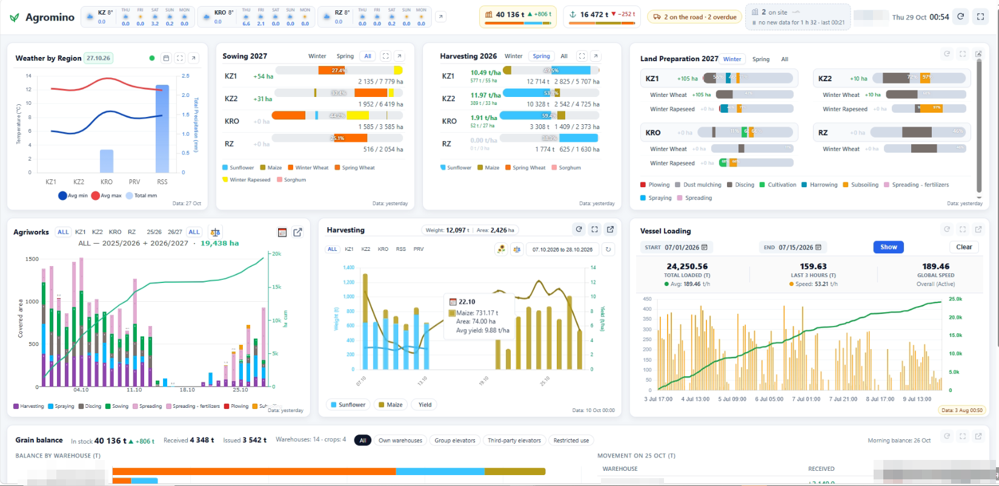
The central executive dashboard consolidates enterprise agribusiness KPIs in real time, encompassing local weather, planting progress, harvest pacing, logistics, and machinery telemetry. Its modular, fault-tolerant architecture guarantees seamless data presentation for executive management across distributed production clusters.

---

### 2. Harvest Telematics Master Reconciliation Table
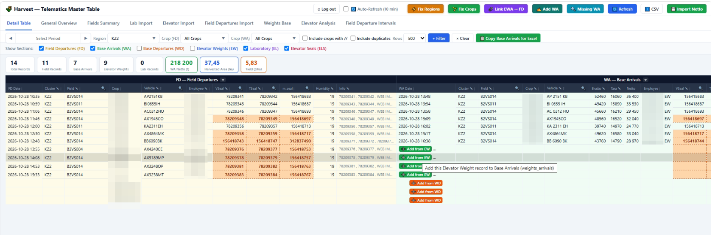
This system delivers automated telematics reconciliation matching combines, chaser bins, and haulage trucks with digital weighbridge tickets for harvest oversight. It detects field-to-scale weight discrepancies and unassigned unloadings in real time while optimizing the logistics chain from field to elevator.

---

### 3. Elevator Truck Flow & Bottleneck Analytics
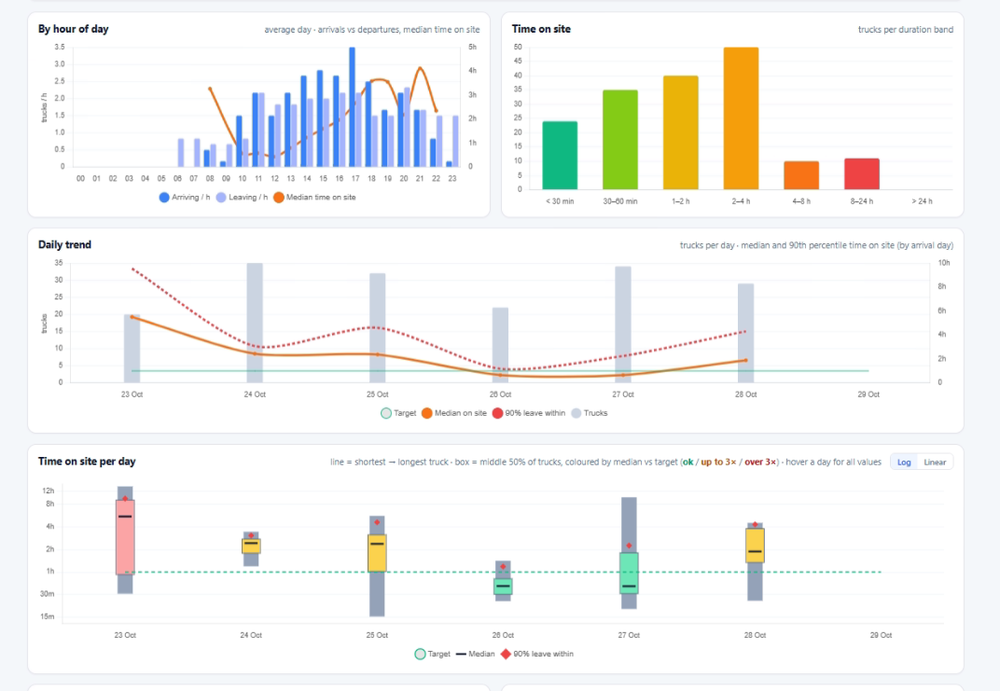
This application analyzes truck turnaround times at the central grain elevator from gross to tare weighing, pinpointing hourly bottlenecks and queue formations. It provides dispatchers with granular dwell time distributions to optimize vehicle dispatching and hauling schedules from the harvest fields.

---

### 4. Security Patrol & Facility Route Verification
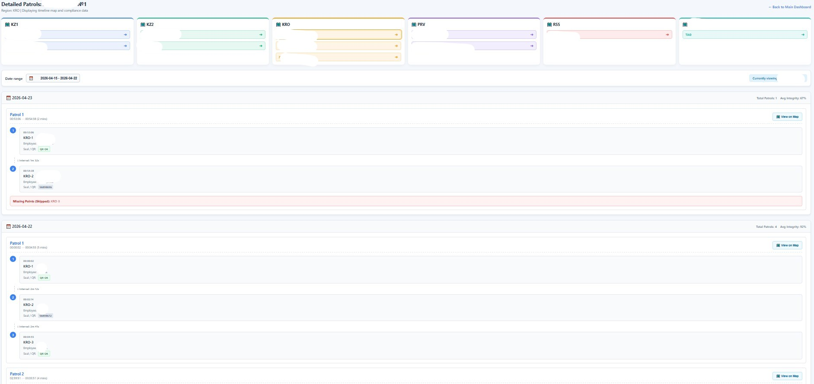
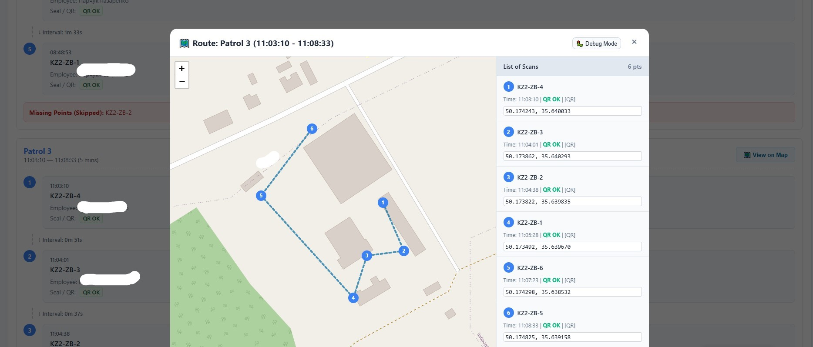
This module continuously monitors security guard patrol rounds across agricultural bases, machinery depots, and weigh stations using electronic checkpoint scans. In addition to real-time status reporting, the integrated GPS mapping interface visualizes the exact physical route walked by security personnel, validating patrol completeness and flagging skipped checkpoints or delayed intervals.

---

### 5. Crop Scouting & Agronomic Threats Heatmap
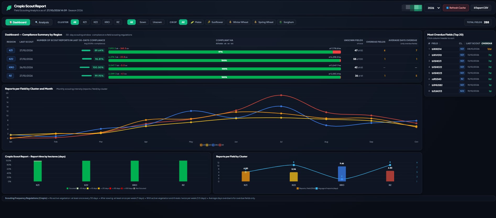
This module aggregates field scouting reports from Cropwise, visualizing crop health and pinpointing weed, disease, and pest threats across production clusters on an interactive map. It delivers early detection of agronomical threats with geotagged photo documentation and field-level spatial precision.

---

### 6. Harvesting Combines Telematics Widget
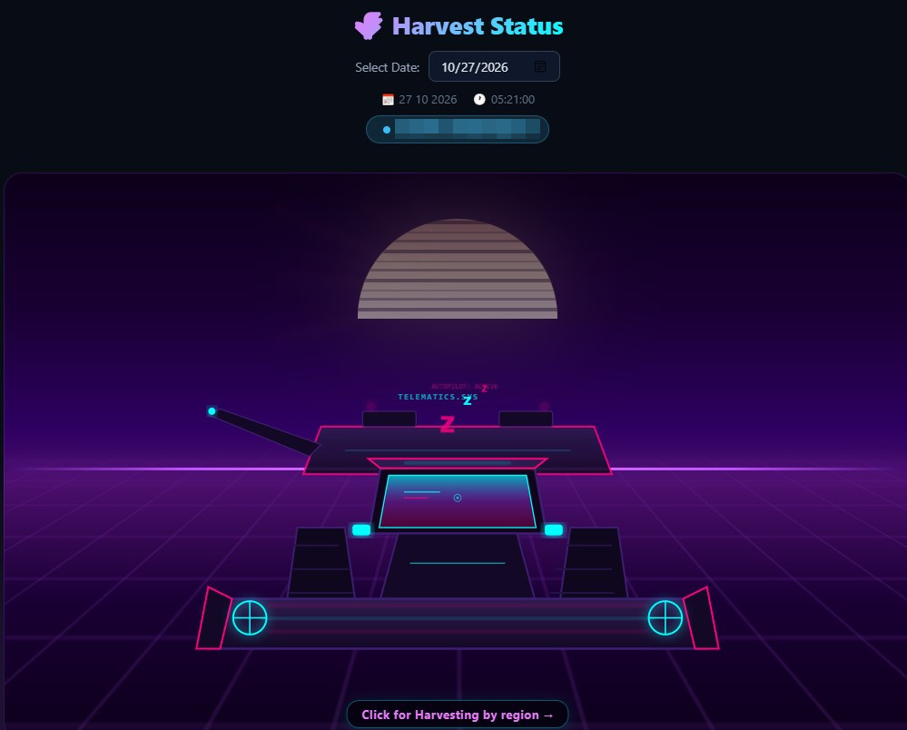
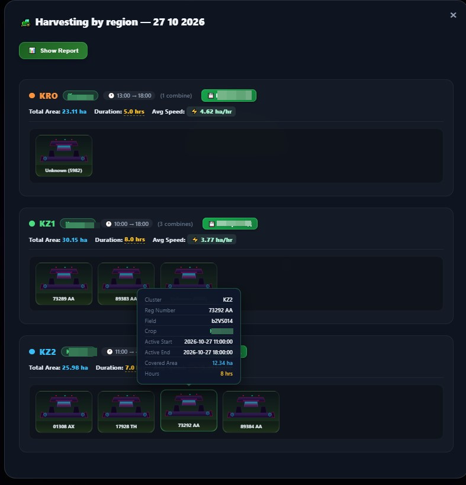
A concept assistant for real-time harvesting status visualization and monitoring. It identifies active field operations and automatically logs combine start/end timestamps, operational downtime, active machine counts, harvested hectares, and average working speeds directly into the database based on live telematics data.

---

### 7. Sowing Logistics & Seeder Loading Telemetry
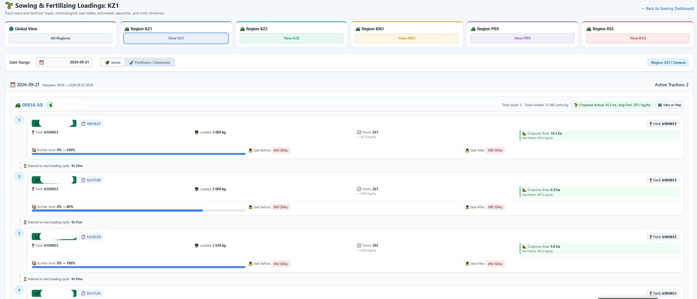
An automated pipeline concept for calculating and verifying seed and fertilizer application rates. It continuously correlates machinery telematics metrics (actual hectares covered by tractors and seed drills) with loading volumes in kilograms, automating compliance checks and inventory tracking without manual calculations.

---

### 8. Sowing Campaign Dynamics & Completion Forecast
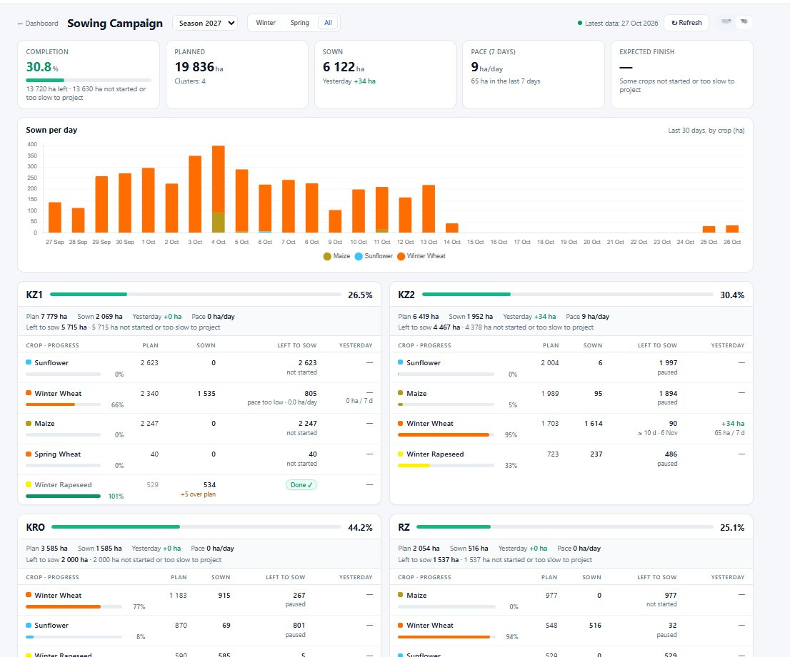
This full-scale sowing campaign dashboard tracks seeded hectares against planned targets, monitoring daily pacing and forecasting completion dates across all agricultural clusters. It offers executive leadership dynamic campaign completion forecasts based on empirical machinery output.

---

### 9. Crop Rotation & Field Operations Synchronization

A system concept for automating data synchronization in Cropwise, updating sowing dates, harvesting dates, harvested grain weight, and actual yield metrics directly into the platform across all fields, eliminating tedious manual entry for farm operators.

---

### 10. Agro-Climatic Weather Analytics
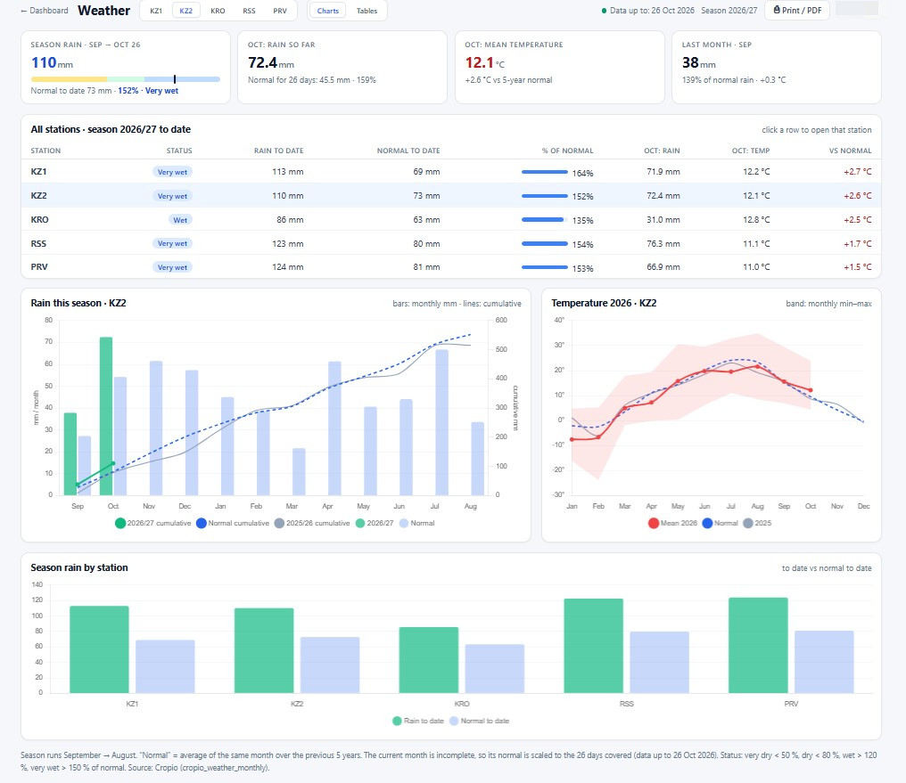
This comprehensive agro-climatic module analyzes precipitation, temperature extremes, snow depth, and wind speeds across local weather stations, benchmarking the current season against 5-year historical norms. It supports agronomic scheduling and early detection of drought and frost stress.

---

## 🧠 Computer Vision & AI Projects

### 11. On-Combine Crop Segmentation & Harvest State
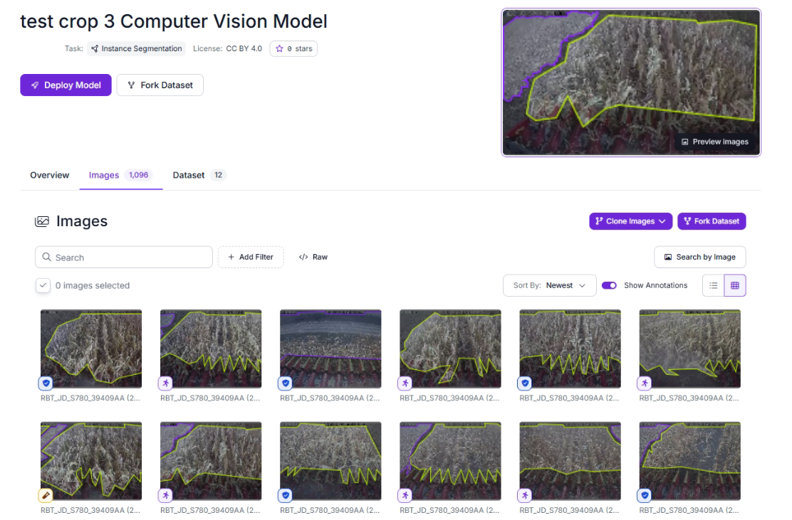
A computer vision semantic segmentation model trained on a custom dataset of on-combine camera footage. It automatically identifies the crop being harvested in real time from live video streams and classifies field status (harvested stubble vs. standing crop) to verify actual harvest progress.

---

### 12. Big-Bag Seed Loading Detection & Inventory Control
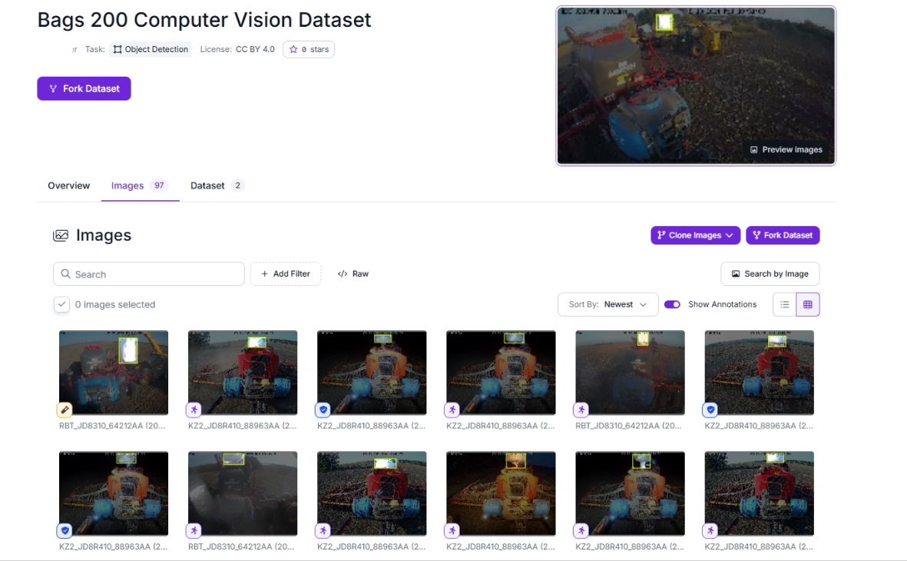
An object detection model trained on Roboflow analyzing field CCTV streams during the sowing campaign. It automatically detects big-bag seed loadings into seed drills, registering exact loading timestamps and counting the number of loaded bags for material auditing and inventory loss control.

---

### 13. Weighbridge AI Timer & Automated Plate OCR
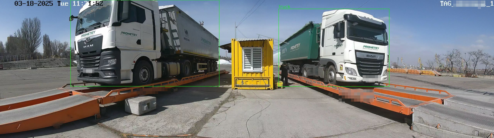

| Real-Time Telegram Alert | Automated End-of-Day Summary |
| :---: | :---: |
| 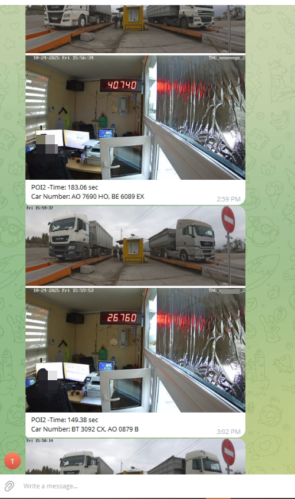 | 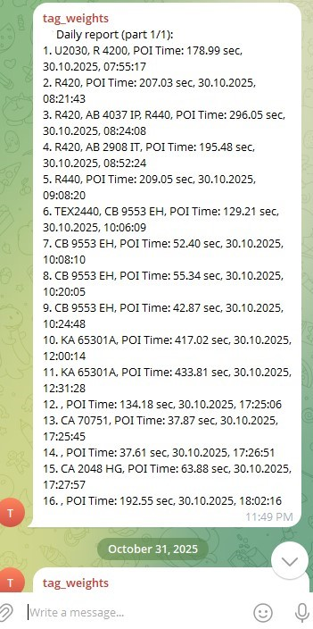 |

An intelligent computer vision system leveraging a YOLO object detection model and polygon ROIs to detect trucks on weighbridges and precisely measure scale dwell times. It coordinates a secondary camera with Google Cloud Vision OCR for automatic license plate recognition (ANPR), dispatching real-time Telegram photo alerts and automated end-of-day summary reports.
